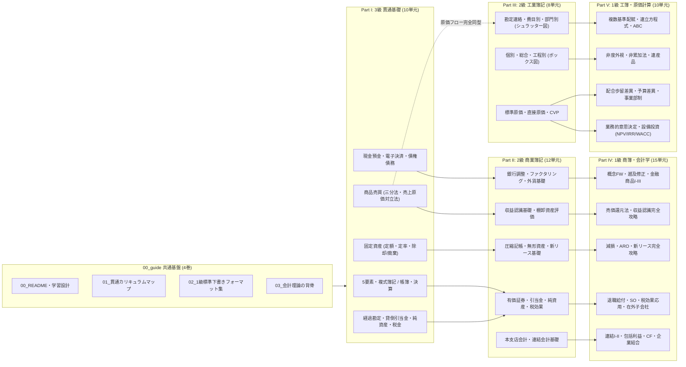

# 貫通カリキュラム全体マップ（全55単元＋2027年4月改定完全対照）

## 1. 縦の6大貫通ライン（Vertical Spine Map）

簿記を「3級・2級・1級」の横割りの暗記として学ぶと、級が上がるたびに学び直し（アンラーン）が発生します。本教材では、全55単元を以下の**縦の6大系統**で貫通設計しています。

| 貫通ライン | 主題 | 3級（土台） | 2級（拡張） | 1級（完成・統合） |
|---|---|---|---|---|
| **Line A** | 資金・決済・金融商品 | `L3-02`, `L3-04`, `L3-05` | `L2C-01`, `L2C-06`, `L2C-08` | `L1C-02`, `L1C-03`, `L1C-04`, `L1C-12` |
| **Line B** | 商品・棚卸・収益・原価フロー | `L3-03`, `L3-09` | `L2C-02`, `L2C-03` / `L2I-01`〜`06` | `L1C-05` / `L1I-01`〜`03` |
| **Line C** | 固定資産・リース・時間価値 | `L3-06` | `L2C-04`, `L2C-05` | `L1C-06`, `L1C-07`, `L1C-08`, `L1I-10` |
| **Line D** | 発生主義・引当・純資産・税 | `L3-07`, `L3-08` | `L2C-07`, `L2C-09`, `L2C-10` | `L1C-09`, `L1C-10`, `L1C-11` |
| **Line E** | F/S構造・企業集団・再編・開示 | `L3-01`, `L3-10` | `L2C-11`, `L2C-12` | `L1C-01`, `L1C-13`, `L1C-14`, `L1C-15` |
| **Line F** | 原価管理・CVP・意思決定 | （`L3-03` 費用の分類） | `L2I-03`, `L2I-07`, `L2I-08` | `L1I-04`〜`L1I-10` |

---

## 2. 全55単元 完全マスタテーブル

### Part I：簿記3級 貫通基礎編（`01_level3/` — 全10単元）

| ID | ファイル名 | 単元名 | 上位理論の柱 | 主な下書き型 | 目標時間 | 重要度 |
|---|---|---|---|---|---|---|
| `L3-01` | `L3-01_elements_and_double_entry.md` | 財務諸表の5要素と複式簿記の構造 | 資産負債・資本等式・複式機構 | 型03 | 50分 | ★★★ |
| `L3-02` | `L3-02_cash_deposits_and_epayments.md` | 現金・預金と電子決済 | 現金主義・資金管理・内部統制 | 型03 | 50分 | ★★★ |
| `L3-03` | `L3-03_merchandise_accounting.md` | 商品売買の会計（三分法と売上原価対立法） | 費用収益対応・取得原価主義 | 型02, 型03 | 60分 | ★★★ |
| `L3-04` | `L3-04_receivables_payables_and_er.md` | 債権・債務と電子記録債権・債務 | 権利義務の発生・金融資産負債 | 型01, 型03 | 50分 | ★★★ |
| `L3-05` | `L3-05_allowance_for_doubtful_accounts.md` | 貸倒引当金と信用リスクの評価 | 保守主義・発生主義・評価性引当金 | 型02, 型03 | 50分 | ★★★ |
| `L3-06` | `L3-06_tangible_fixed_assets.md` | 有形固定資産の取得・償却・売却・除却・廃棄 | 費用配分の原則・取得原価主義 | 型01, 型03 | 60分 | ★★★ |
| `L3-07` | `L3-07_accruals_deferrals_and_supplies.md` | 発生主義と経過勘定・貯蔵品 | 発生主義・期間損益計算 | 型01 | 50分 | ★★★ |
| `L3-08` | `L3-08_equity_and_taxes.md` | 株式会社の純資産と税金（法人税等・消費税） | 資本取引と損益取引の区分 | 型03 | 50分 | ★★☆ |
| `L3-09` | `L3-09_books_vouchers_and_error_correction.md` | 帳簿組織・商品有高帳・伝票・訂正仕訳 | 原価フロー仮定・内部牽制 | 型02, 型03 | 60分 | ★★★ |
| `L3-10` | `L3-10_closing_and_financial_statements.md` | 決算手続の全体構造と財務諸表の作成 | 期間損益確定・B/SとP/Lの連携 | 型03 | 60分 | ★★★ |

### Part II：簿記2級 商業簿記編（`02_level2_commercial/` — 全12単元）

| ID | ファイル名 | 単元名 | 上位理論の柱 | 主な下書き型 | 目標時間 | 重要度 |
|---|---|---|---|---|---|---|
| `L2C-01` | `L2C-01_bank_reconciliation_and_factoring.md` | 銀行勘定調整表と債権の流動化（ファクタリング） | 実在性検証・金融資産の消滅 | 型03, 型04 | 60分 | ★★★ |
| `L2C-02` | `L2C-02_revenue_recognition_basics.md` | 収益認識会計基準の基礎（5ステップ・契約資産負債） | 資産負債アプローチ・支配の移転 | 型01, 型03 | 60分 | ★★★ |
| `L2C-03` | `L2C-03_inventory_valuation.md` | 棚卸資産の評価と期末整理（減耗・低価法） | 取得原価主義・収益性の低下 | 型02 | 60分 | ★★★ |
| `L2C-04` | `L2C-04_advanced_fixed_assets_basics.md` | 固定資産の拡張（生産高比例法・圧縮記帳・無形資産） | 費用配分・資本/損益取引 | 型01, 型03 | 60分 | ★★☆ |
| `L2C-05` | `L2C-05_new_lease_accounting_basics.md` | 新リース会計基準・基礎（使用権資産・リース負債） | 使用権モデル・オンバランス原則 | 型01, 型04 | 75分 | ★★★ |
| `L2C-06` | `L2C-06_securities_accounting.md` | 有価証券の4分類と評価（償却原価法・全部純資産直入） | 保有目的別測定・時価評価 | 型01, 型04 | 75分 | ★★★ |
| `L2C-07` | `L2C-07_provisions_and_liabilities.md` | 引当金の4要件と負債会計（賞与・退職給付基礎等） | 発生主義・負債性引当金 | 型01, 型08 | 60分 | ★★★ |
| `L2C-08` | `L2C-08_foreign_currency_basics.md` | 外貨建取引の基礎と為替予約（振当処理） | 貨幣/非貨幣項目・ヘッジ実態 | 型01 | 60分 | ★★☆ |
| `L2C-09` | `L2C-09_net_assets_and_ss.md` | 純資産会計と株主資本等変動計算書（S/S・合併入口） | 資本充実・維持・剰余金区分 | 型03 | 60分 | ★★★ |
| `L2C-10` | `L2C-10_tax_effect_basics.md` | 税効果会計の基礎（一時差異・繰延税金資産負債） | 税引前利益と法人税等の対応 | 型09 | 60分 | ★★★ |
| `L2C-11` | `L2C-11_head_office_and_branch.md` | 本支店会計（未達事項・内部利益控除・合併F/S） | 企業実体・内部取引相殺 | 型02, 型03 | 60分 | ★★☆ |
| `L2C-12` | `L2C-12_consolidation_basics.md` | 連結会計の基礎（資本連結・のれん・成果連結） | 経済的単一体説・支配獲得 | 型07 | 90分 | ★★★ |

### Part III：簿記2級 工業簿記編（`03_level2_industrial/` — 全8単元）

| ID | ファイル名 | 単元名 | 上位理論の柱 | 主な下書き型 | 目標時間 | 重要度 |
|---|---|---|---|---|---|---|
| `L2I-01` | `L2I-01_cost_accounting_overview.md` | 工業簿記の全体像・原価概念・勘定連絡図 | 原価計算基準・財務諸表連結 | 型03 | 50分 | ★★★ |
| `L2I-02` | `L2I-02_cost_elements.md` | 費目別計算（材料費・労務費・経費・予定単価差異） | 原価の消費額測定・迅速性 | 型02, 型03 | 60分 | ★★★ |
| `L2I-03` | `L2I-03_overhead_and_departmental.md` | 製造間接費の配賦と部門別計算（シュラッター図） | 原因帰属原則・公式法変動予算 | 型05 | 70分 | ★★★ |
| `L2I-04` | `L2I-04_job_order_costing.md` | 個別原価計算（製造指図書・仕損費・作業屑） | 個別製品の原価集計 | 型03 | 60分 | ★★★ |
| `L2I-05` | `L2I-05_process_costing_basics.md` | 総合原価計算の基礎（完成品換算量・度外視法） | 投入＝産出・進捗度按分 | 型02 | 70分 | ★★★ |
| `L2I-06` | `L2I-06_process_costing_variations.md` | 工程別・組別・等級別総合原価計算（累加法） | 工程間振替・等価係数按分 | 型02 | 60分 | ★★☆ |
| `L2I-07` | `L2I-07_standard_costing_basics.md` | 標準原価計算（差異分析体系・パーシャル/シングル） | 原価管理・例外管理の原則 | 型06 | 70分 | ★★★ |
| `L2I-08` | `L2I-08_direct_costing_cvp_and_factory.md` | 直接原価計算・CVP分析・本社工場会計 | 固定費期間費用説・利益計画 | 型03, 型10 | 70分 | ★★★ |

### Part IV：簿記1級 商業簿記・会計学編（`04_level1_commercial/` — 全15単元）

| ID | ファイル名 | 単元名 | 上位理論の柱 | 主な下書き型 | 目標時間 | 重要度 |
|---|---|---|---|---|---|---|
| `L1C-01` | `L1C-01_conceptual_framework_and_changes.md` | 概念フレームワーク・一般原則・会計上の変更と誤謬訂正 | 意思決定有用性・遡及適用 | 型01 | 70分 | ★★★ |
| `L1C-02` | `L1C-02_financial_instruments_receivables.md` | 金融商品会計Ⅰ：債権3区分・CF見積法・消滅認識 | 財務構成要素アプローチ・現価 | 型04 | 80分 | ★★★ |
| `L1C-03` | `L1C-03_financial_instruments_securities_bonds.md` | 金融商品会計Ⅱ：有価証券・社債利息法・減損・新株予約権付社債 | 実効金利法・実物/金融投資区分 | 型04 | 90分 | ★★★ |
| `L1C-04` | `L1C-04_derivatives_and_hedge_accounting.md` | 金融商品会計Ⅲ：デリバティブとヘッジ会計 | 時価評価・損益認識時点の整合 | 型01, 型04 | 90分 | ★★★ |
| `L1C-05` | `L1C-05_inventory_retail_and_revenue_advanced.md` | 売価還元法と収益認識会計基準・完全攻略 | 履行義務・変動対価・金融要素 | 型02, 型04 | 90分 | ★★★ |
| `L1C-06` | `L1C-06_impairment_intangibles_and_compression.md` | 固定資産の高度論点Ⅰ：減損会計・ソフトウェア・積立金圧縮 | 回収可能価額・投資の回収可能性 | 型01, 型04 | 90分 | ★★★ |
| `L1C-07` | `L1C-07_asset_retirement_obligations.md` | 固定資産の高度論点Ⅱ：資産除去債務（ARO）・敷金・交換 | 負債計上と資産配分・割引率非対称 | 型01, 型04 | 90分 | ★★★ |
| `L1C-08` | `L1C-08_new_lease_accounting_mastery.md` | 新リース会計基準・完全攻略（借手高度・S&LB・サブリース・貸手） | 企業会計基準第34号完全体系 | 型01, 型04 | 100分 | ★★★ |
| `L1C-09` | `L1C-09_retirement_benefits.md` | 退職給付会計（PBO・年金資産ワークシート・個別と連結） | 労働対価の後払・遅延認識/即時認識 | 型08 | 100分 | ★★★ |
| `L1C-10` | `L1C-10_equity_treasury_and_stock_options.md` | 純資産会計・自己株式・新株予約権・ストック・オプション | 払込資本と留保利益・公正価値測定 | 型01, 型03 | 80分 | ★★★ |
| `L1C-11` | `L1C-11_tax_effect_advanced.md` | 税効果会計の応用（回収可能性・税率変更・連結一時差異） | 資産負債法・スケジューリング | 型09 | 80分 | ★★★ |
| `L1C-12` | `L1C-12_foreign_currency_and_subsidiaries.md` | 外貨建取引の応用と在外子会社の財務諸表換算 | 機能通貨・テンポラル/CR法 | 型01, 型07 | 90分 | ★★★ |
| `L1C-13` | `L1C-13_consolidation_capital_and_equity_method.md` | 連結会計Ⅰ：資本連結の完全体系と持分法 | 親会社説/経済的単一体説・支配変動 | 型07 | 110分 | ★★★ |
| `L1C-14` | `L1C-14_consolidation_income_oci_and_cf.md` | 連結会計Ⅱ：成果連結・包括利益・個別/連結CF計算書 | リサイクリング・資金収支への変換 | 型03, 型07 | 110分 | ★★★ |
| `L1C-15` | `L1C-15_business_combinations_and_disclosure.md` | 企業結合・事業分離・EPS・セグメント情報 | 投資の継続と清算・時価評価 | 型07 | 100分 | ★★★ |

### Part V：簿記1級 工業簿記・原価計算編（`05_level1_industrial/` — 全10単元）

| ID | ファイル名 | 単元名 | 上位理論の柱 | 主な下書き型 | 目標時間 | 重要度 |
|---|---|---|---|---|---|---|
| `L1I-01` | `L1I-01_cost_standards_and_advanced_departmental.md` | 原価計算基準と部門別計算の高度化（複数基準・連立方程式） | 固定費/変動費の別個配賦・責任会計 | 型05, 型10 | 80分 | ★★★ |
| `L1I-02` | `L1I-02_advanced_process_costing_1.md` | 総合原価計算の高度論点Ⅰ（非度外視・非累加法・加工費工程別） | 正常/異常の区分・完成品換算原価 | 型02 | 90分 | ★★★ |
| `L1I-03` | `L1I-03_joint_products_and_byproducts.md` | 総合原価計算の高度論点Ⅱ（連産品・副産物・追加加工判断） | 結合原価の負担能力按分・増分利益 | 型02, 型10 | 80分 | ★★★ |
| `L1I-04` | `L1I-04_advanced_standard_costing.md` | 標準原価計算の高度論点（配合・歩留差異・原価差異按分） | 投入構成と能率の分離 | 型06 | 90分 | ★★★ |
| `L1I-05` | `L1I-05_advanced_cvp_and_product_mix.md` | 直接原価計算・CVP応用と最適セールス・ミックス（LP） | 制約条件下の貢献利益最大化 | 型10 | 80分 | ★★★ |
| `L1I-06` | `L1I-06_budgeting_and_variance_analysis.md` | 予算管理と予算実績差異分析（市場総需要・占有率差異） | 外部環境要因と内部努力の分解 | 型06, 型10 | 80分 | ★★★ |
| `L1I-07` | `L1I-07_divisional_performance_and_transfer_pricing.md` | 分権組織の業績評価（ROI・RI・EVA）と内部振替価格 | 目標整合性・機会原価下限価格 | 型10 | 80分 | ★★★ |
| `L1I-08` | `L1I-08_strategic_cost_management.md` | 戦略的原価管理（ABC/ABM・品質原価・原価企画・LCC） | 活動基準原価計算・上流原価低減 | 型10 | 75分 | ★★☆ |
| `L1I-09` | `L1I-09_operational_decision_making.md` | 業務的意思決定（差額原価収益・機会/埋没原価・EOQ） | 関連原価の識別・短期最適化 | 型10 | 90分 | ★★★ |
| `L1I-10` | `L1I-10_capital_budgeting_and_uncertainty.md` | 設備投資の経済性計算（NPV・IRR・取替投資・WACC）と不確実性 | 貨幣の時間価値・タックスシールド | 型01, 型04, 型10 | 100分 | ★★★ |

---

## 3. 2027年4月改定・新基準 完全対照マトリクス

2027年4月1日以降の試験（統一試験・ネット試験・団体試験すべて）から適用される改定内容を、本教材では全級にわたり標準実装しています。

| 級 | 削除・除外された論点 | 追加・移行・刷新された論点 | 本教材での対応単元 |
|---|---|---|---|
| **3級** | 紙の手形（約束手形・為替手形・受取/支払手形）および紙の小切手 | ①**売上原価対立法**の追加 ②**定率法による減価償却**の追加 ③**有形固定資産の除却・廃棄**の追加 ④電子記録債権・債務およびキャッシュレス決済への整理 | `L3-02`, `L3-03`, `L3-04`, `L3-06` |
| **2級** | 紙の手形・小切手に関する処理、旧リース基準（ファイナンス/オペレーティング区分による借手賃貸借処理） | ①**新リース会計基準（第34号）**の借手基礎（使用権資産・リース負債・利子抜き/込み・短期/少額リース） ②**ファクタリング（2社間・3社間）**の明確化 | `L2C-01`, `L2C-05` |
| **1級** | 紙の手形・小切手に関する処理、旧リース基準 | ①**新リース会計基準（第34号）**の完全適用（リースの識別・期間・利息法・契約変更・セール＆リースバック・サブリース・借地権・貸手処理） | `L1C-08` |
| **工簿・原価** | 大きな変更なし | 原価計算基準・現代的管理会計手法の一貫体系を維持 | `L2I-01`〜`08`, `L1I-01`〜`10` |

---

## 4. Part VIII：実務現場・財務分析・制度背景バイブル（`08_practice_and_analysis/` — 全8巻）

Part I〜VII で習得した仕訳・計算・理論を「実際の企業現場・投資家評価・法制度・産業構造」と接続する実践編です（各巻から該当単元へ直接ジャンプ可能）。

| ID | タイトル | 主なテーマ | 直結する既存単元 |
|---|---|---|---|
| `PR-01` | 月次決算の実務カレンダーとPOS・クレジット精算・資金消込 | 営業日1〜10日スケジュール・PSP消込・銀行調整 | `L3-02`, `L3-04`, `L3-07`, `L2C-01`, `L2C-02` |
| `PR-02` | 実地棚卸・固定資産台帳・工場原価計算の現場オペレーション | カットオフ・現物照合・産廃証憑・標準差異会議 | `L3-03`, `L3-06`, `L2C-03`, `L2C-05`, `L2I-02`〜`07` |
| `PR-03` | 決算整理仕訳の内部統制・J-SOX・会計監査対応 | 職務分掌・3点照合・RCM・棚卸立会・残高確認 | `L3-05`, `L3-09`, `L2C-07`, `L2C-10`, `L1C-01`, `L1C-06` |
| `PR-04` | 財務分析・投資家目線Ⅰ：ROA・ROE・CCC・安全性指標と簿記の接続 | デュポン分解・黒字倒産・当座比率・コベナンツ | `G-03`, `L3-01`〜`10`, `L2C-01`, `L2C-09`, `L1I-07` |
| `PR-05` | 財務分析・投資家目線Ⅱ：会計基準・見積りが企業価値と指標をどう変えるか | 新リース第34号影響・EBITDA・PBR＝ROE×PER | `L2C-02`, `L2C-05`, `L1C-05`, `L1C-08`, `L1I-10` |
| `PR-06` | 制度・法改正背景の完全ガイド：2027年改定・IFRS・3法トライアングル | 紙手形廃止・IFRS統合・会社法×金商法×法人税法 | `G-01`, `L3-04`, `L3-08`, `L2C-10`, `L1C-11`, `EX-01` |
| `PR-07` | ビジネスモデル別・決算書解剖図鑑（小売・SaaS・EC・製造・不動産・銀行） | 負のCCC・契約負債・純額表示・営業レバレッジ | `L3-03`, `L2C-02`, `L2I-08`, `L1C-04`, `L1C-05` |
| `PR-08` | キャッシュフロー経営・資金繰り・M&Aと会計不正（粉飾）の解剖学 | 資金繰り表・PPAとのれん・粉飾5大パターン | `L1C-10`, `L1C-13`, `L1C-14`, `L1C-15`, `PR-03`, `PR-04` |
